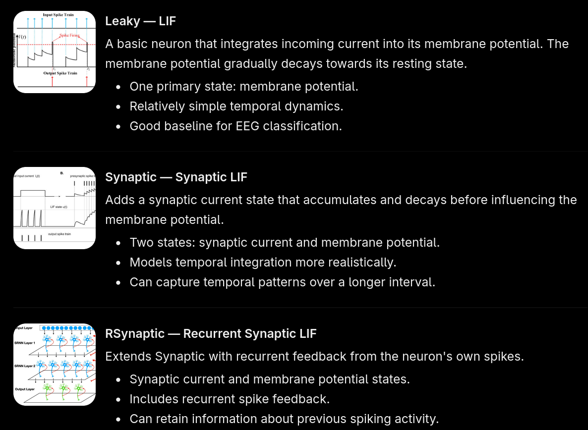

# RSynaptic for EEG

EEG signals are continuous time series. They can be encoded into spike trains and processed by an RSynaptic spiking neural network to learn temporal patterns.

## Internal states

An RSynaptic neuron maintains:

1. **Synaptic current** $I_{\mathrm{syn}}$: Accumulates incoming signals and decays over time.
2. **Membrane potential** $U$: Integrates synaptic current and decays over time.

Its dynamics are approximately:

$$
I_{\mathrm{syn}}[t+1]
=
\alpha I_{\mathrm{syn}}[t]
+ V S[t]
+ I_{\mathrm{in}}[t+1]
$$

$$
U[t+1]
=
\beta U[t]
+ I_{\mathrm{syn}}[t+1]
- R U_{\mathrm{thr}}
$$

- $I_{\mathrm{in}}[t+1]$ is the external input at the next time step.
- $S[t]$ is the neuron's previous output spike.
- $V$ represents the recurrent weight.
- $R$ controls reset behavior.

The recurrent component feeds the neuron's previous output spikes back into its synaptic current.

## EEG processing pipeline

1. **Raw EEG**

   - Electrode recordings with shape `[trials, channels, samples]`.
   - This project uses 128 EEG channels.
2. **Preprocessing**

   - Filtering
   - Normalization
   - Optional frequency-band extraction
3. **Spike encoding**

   - Encode the 128 channels as 256 input neurons:
     - 128 up-neurons
     - 128 down-neurons
   - Record an up or down spike when the channel signal changes beyond a threshold.
4. **RSynaptic SNN**

   - Process spike trains over time.
   - Learn temporal patterns with recurrent synaptic activity.
5. **Classification**

   - Examples include seizure detection and sleep-stage classification.
   - This project performs four-class word classification.

The generated spike tensors have shape `[trials, 1153, 256]`, followed by subject, session, condition, and label metadata.

> The model in [example_usage.py](/home/kaffe/Universitet/ltu/eeg-decoding/scripts/example_usage.py) currently uses `snntorch.Leaky` neurons and has no recurrent connections. Replacing `Leaky` with `RSynaptic` requires adding recurrent weights or using an RSynaptic-compatible recurrent layer.

| Parameter / argument | Purpose |
|---|---|
| `in_features` | Number of neurons represented by the RSynaptic layer. It defines the input and recurrent weight dimensions. |
| `alpha` | Synaptic-current decay factor. Larger values retain current longer; smaller values make it decay faster. |
| `beta` | Membrane-potential decay factor. Controls how quickly previous membrane potential influences the next timestep. |
| `threshold` | Membrane potential required for the neuron to emit a spike. |
| `recurrent_strength` | Scales the contribution of the recurrent weight matrix to synaptic current. |
| `reset_strength` | Scales the membrane reset after a spike. |
| `surrogate_slope` | Controls the steepness of the sigmoid surrogate gradient used during backpropagation. |
| `input_current` | External input to a neuron timestep, usually the output of `fc1` or another dense layer. |
| `prev_spike` | Previous spike output, fed back through the recurrent weight matrix. |
| `synaptic_current` | Internal accumulated synaptic current retained between timesteps. |
| `membrane` | Internal membrane potential retained between timesteps. |
| `n_in` | Number of input features in `Net`; defaults to 256 for the 128-channel up/down EEG spike encoding. |
| `n_hidden` | Number of hidden RSynaptic neurons; defaults to 128. |
| `n_out` | Number of output classes; defaults to 4. |
| `x` | EEG spike tensor shaped `[batch, time, 256]`. |
| `batch_size` | Number of EEG trials processed in parallel. |
| `num_steps` | Number of timesteps in `x`; all available timesteps are processed automatically. |
| `n_in` inside `forward` | Checks that the final dimension of `x` matches the `fc1` input size. |
| `device` | Device on which `x` and the model tensors are stored, such as CPU or CUDA. |
| `dtype` | Tensor precision, used when initializing hidden and membrane states. |
| `synaptic` | Batched synaptic-current state for the hidden layer. |
| `spike` | Batched hidden-layer spike state from the previous timestep. |
| `membrane` | Batched membrane-potential state for the hidden layer. |
| `output_membrane` | Accumulated membrane state at the output layer. |
| `output_membranes` | Output membrane trace collected across every timestep. |
| `output_decay` | Uses `beta` to decay the output membrane between timesteps. |
