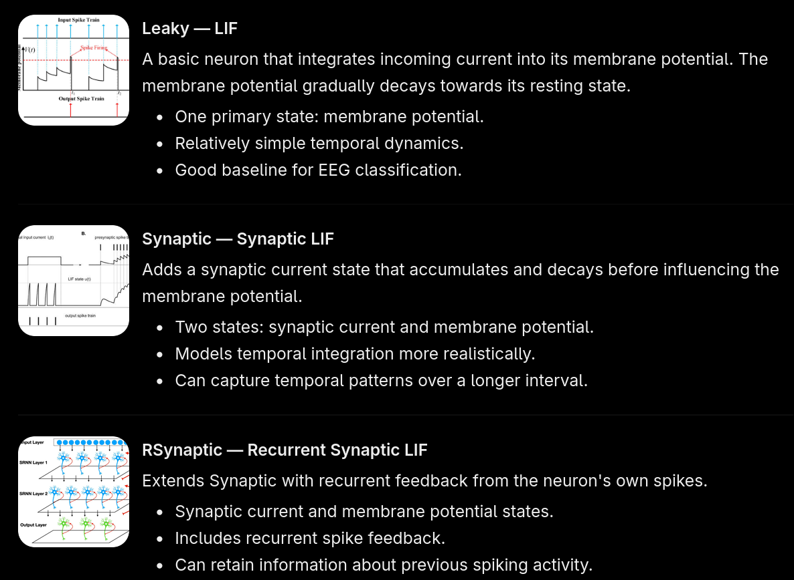

# Hello

## Neuron models

The project compares membrane-only LIF neurons, synaptic-current neurons, and recurrent synaptic (RSynaptic) neurons:

For details about the RSynaptic implementation, see [RSynaptic for EEG](./docs/RSynaptic.md).

Current structure of the project

| Folder | Purpose |
|---|---|
| `data/` | Datasets and other project data |
| `docs/` | Project documentation and reports |
| `functions/` | All functions used by all members |
| `models/` | Saved models (tensors or definitions) |
| `scripts/` | Seldomly run scripts |
| `readME.md` | Project README and usage information |

In the google drive folder (linked it in the planning document) there is an "ALL_spikes.pt" generated from the derivatives of the NIETO dataset using the "create_all_spikes.py" script. Download it and place it as "data/ALL_spikes.pt". It will probably be updated later but is usable as a start. Works with the "example_usage.py" implementation. 

Then load.spikes() should work.

DATAPROCESSING:
To spikes(Script in script/create_all_spikes.py):

Each EEG channel becomes one up and one down neuron (256 input neurons)
Go through each sample and calculate delta. If delta is less than DOWN_threshold register a down spike. If delta is more than UP_threshold register an up spike.

Creates:
All_spikes.pt:
[spikes([N_trials(0-5639)*N_samples(4.5*256Hz=0-1153)*num_neurons(0-255)],
session(0-2),
subject(0-9),
condition(0-2),
class(0-3)]

To train,val,test:
Solution 1(inter-subject)(35-50% SOTA)
Session 1 and 2 = train
Session 3 = val and test

Solution 2 (leave-one-subject-out)(25% SOTA)
Subject 1-8 = train
Subject 9 = val
Subject 10 = test

Load data(in functions/load.py):
set = load.spikes(filepath, set_type, solution, condition,start_time, end_time)

start and end time is to be able to crop to just the signal when the subject is thinking/pronouncing or visualising the direction

ex.
train = load.spikes(“home/usr/all_spikes.pt”, train, 1)
val = load.spikes(“home/usr/all_spikes.pt”,val 1)
test = load.spikes(“home/usr/all_spikes.pt”, test, 1)
Or
filepath = config.All_spikes_filepath
set_type = config.All_spikes_set_type
solution = config.All_spikes_set_type
